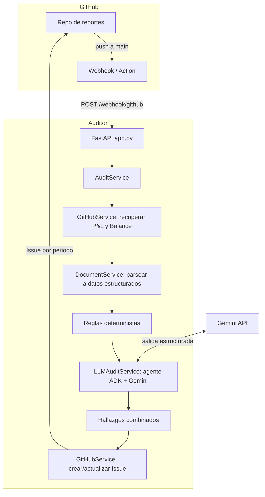

# Diagrama de Arquitectura - Sistema de Auditoría Financiera

## Leyenda

- **Reglas deterministas**: periodo, utilidad neta, ecuación contable y ratios; exactas y sin costo.
- **LLMAuditService**: `LlmAgent` de Google ADK con `output_schema`; revisa totales, clasificación y anomalías que las reglas no cubren. Si falla, la auditoría continúa solo con las reglas.
- **Issue por periodo**: el título es estable (`Auditoría Financiera - <periodo>`), por lo que cada auditoría actualiza el issue abierto en lugar de duplicarlo.
