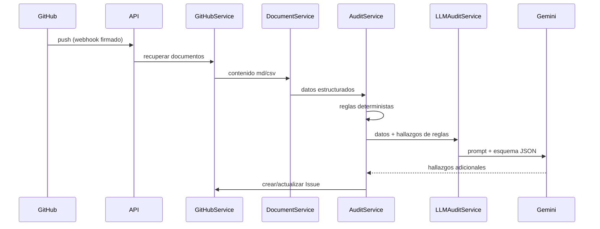

# Racionalización de Arquitectura

## Componentes Principales

### 1. Capa de entrada
- **Webhook de GitHub** (`POST /webhook/github`): firma HMAC-SHA256 obligatoria; responde 202 y audita en segundo plano.
- **`POST /audit`**: auditoría manual protegida con `X-API-Key`.
- **CLI**: `python -m auditor.agent` audita un repo de GitHub; `python -m auditor.demo` audita archivos locales sin GitHub.
- **Docker**: imagen opcional para la API (`docker compose up`).

### 2. Servicios (`auditor/services`)
- **GitHubService**: localiza P&L y Balance, y crea/actualiza el Issue del periodo.
- **DocumentService**: convierte Markdown/CSV a datos estructurados con `Decimal`.
- **AuditService**: orquesta el flujo y aplica las reglas deterministas.
- **LLMAuditService**: agente ADK (`LlmAgent`) con Gemini y salida estructurada (Pydantic).

### 3. Por qué reglas + LLM
- Las **reglas** son exactas, reproducibles y gratuitas: las identidades contables no deben depender de un modelo.
- **Gemini** aporta lo que las reglas no pueden enumerar: totales que no suman, partidas mal clasificadas, montos anómalos y explicaciones accionables.
- Gemini recibe los hallazgos de las reglas para no repetirlos, usa temperatura 0 y devuelve JSON validado; cada hallazgo queda marcado con su origen.
- Si Gemini no está disponible (sin API key, cuota, error), la auditoría sigue con las reglas y el resultado lo indica (`llm_error`).

## Flujo de Datos

## Modos de Fallo

### 1. Document Retrieval
- **Fallo en acceso**: Timeout o permisos insuficientes
- **Formato inválido**: Estructura no reconocida
- **Archivos faltantes**: Documentos no encontrados

### 2. Processing
- **Timeouts**: Análisis excede límites
- **Parsing**: Errores en conversión
- **Datos**: Inconsistencias en valores

### 3. Issue Management
- **Creación**: Fallos en API de GitHub
- **Permisos**: Tokens inválidos
- **Rate Limiting**: Límites de API excedidos

## Estrategia de Escalado

### 1. Horizontal Scaling
- **Docker**: Múltiples instancias
- **Webhooks**: Load balancing
- **Caché**: Documentos frecuentes

### 2. Vertical Scaling
- **Prompts**: Optimización de reglas
- **Parsers**: Mejora de rendimiento
- **Caché**: Resultados de análisis

### 3. Future Scaling
- **Formatos**: Soporte extendido
- **Repos**: Múltiples fuentes
- **Análisis**: Histórico y tendencias

## Métricas Clave

### 1. Performance
- **Procesamiento**: < 30 segundos por documento
- **Detección**: > 95% de discrepancias
- **Precisión**: < 1% de falsos positivos

### 2. Reliability
- **Uptime**: > 99.9%
- **Fallos**: < 0.1% de requests
- **Recuperación**: < 5 minutos

### 3. Business Impact
- **Errores**: Reducción del 90%
- **Tiempo**: Ahorro de 20 horas/semana
- **Calidad**: Mejora del 95% en reportes 